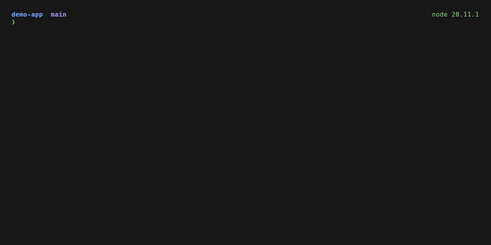

# bash-gitaware

Un prompt de bash que conoce git y no estorba. Bash puro 4.4+, sin más
dependencias que git.



[English](README.md) · [Migrar desde v2](docs/MIGRATION.md) ·
[Decisiones](docs/adr/) · [Changelog](CHANGELOG.md) · [Seguridad](SECURITY.md)

## Qué se ve

```text
❯ make test
...output...
  ✘1 · 3s
~/src/project  main ● ↑1                              python 3.12
❯ _
```

- Línea 1: la ruta (relativa a la raíz dentro de un repositorio) y git. Git
  muestra la rama, el estado de rebase o merge, una marca de cambios sin
  commitear, los commits adelante/atrás y los stashes. Los runtimes
  (Python, Node, Rust, Go, Ruby, Deno, Bun, Java) se alinean a la derecha.
- Línea 2: el símbolo del prompt, en rojo después de un fallo.
- Tras un comando que falló o superó el umbral de tiempo, queda una línea
  de resultado (`  ✘1 · 3s`) en el historial de la terminal.
- Al pulsar Enter, el prompt se colapsa a `❯ <comando>`, así el historial
  queda compacto.

La parte costosa de `git status` corre en segundo plano. En un repositorio
de 100.000 archivos el prompt tarda unos 11 ms.

## Instalación

```bash
git clone https://github.com/SzematPro/bash-gitaware ~/.bash-gitaware
cd ~/.bash-gitaware
./install.sh            # asks: append or replace, theme, glyphs, shell defaults
exec bash
```

Con `./install.sh --yes` se usan los valores por defecto sin preguntas
(modo replace, con copia de seguridad de `~/.bashrc`), y
`./install.sh --uninstall` deshace la instalación.

## Configuración

La configuración está en `~/.config/bash-gitaware/config`. El archivo es
`clave = valor` en texto plano y nunca se ejecuta con `source`. Se cambia
con `bga`:

```bash
bga config set theme light      # aware, light, contrast
bga config set style classic    # the v2 three-line layout
bga theme preview contrast
bga config edit                 # opens $VISUAL or $EDITOR, checks before saving
bga config list --all           # every setting, its value and where it comes from
bga doctor                      # checks your setup
bga reload                      # applies changes to this shell
```

| Clave | Valores | Por defecto |
|---|---|---|
| `style` | `lean`, `classic` | `lean` |
| `theme` | `aware`, `light`, `contrast` | `aware` |
| `glyphs` | `nerd`, `unicode`, `ascii` | automático (`unicode` en UTF-8) |
| `clock` | `0`, `1` | `0` |
| `commit_line` | `0`, `1` | `0` en Lean, `1` en classic |
| `path_maxdepth` | número (`0` significa sin límite) | `3` |
| `timer_threshold` | segundos | `2` |
| `show_host` | `auto`, `always`, `never` | `auto` (por SSH o como root) |
| `mode` | `auto`, `plain`, `full` | `auto` |
| `runtimes` | lista separada por comas de `py`, `node`, `rust`, `go`, `ruby`, `deno`, `bun`, `java` | todos |
| `vi_mode` | `auto`, `0` | `auto` (marca en el modo comando de vi) |
| `contexts` | lista separada por comas de `kube` (contexto de kubectl), `aws` (perfil), `tf` (workspace de Terraform) | ninguno |
| `git_status` | `compact` (un `●`), `detail` (`+staged !unstaged ?untracked ✘conflicts`) | `compact` |
| `progress` | `0`, `1` (progreso en la barra de tareas mientras corre un comando, OSC 9;4) | `0` |
| `shell_defaults` | `0`, `1` | lo escribe el instalador (ver abajo) |

`bga` completa sus comandos, claves y valores con TAB.

Cada clave también funciona como variable de entorno (`BASHGITAWARE_THEME`,
etc.), que tiene prioridad sobre el archivo. Se respeta `NO_COLOR`. La
lista completa está en [docs/MIGRATION.md](docs/MIGRATION.md).

## Ajustes de shell

bash-gitaware también puede aplicar lo que trae un `~/.bashrc` estándar de
Debian/Ubuntu: opciones de historial (`HISTCONTROL=ignoreboth`,
`HISTSIZE=10000`, `HISTFILESIZE=20000`, `histappend`), los alias `ll`,
`la`, `l` y `alert`, los alias de git `gs`, `ga`, `gc`, `gp`, `gl`, `gd`,
`gb`, `gco`, `gst` y `gsp`, y `~/.bash_aliases`. Si el sistema los tiene
(`/usr/bin/dircolors`, `/usr/bin/lesspipe`, las rutas de bash-completion de
Debian), también aplica colores para `ls`/`grep`, `lesspipe` y el
autocompletado.

```bash
bga config set shell_defaults 0    # prompt only
bga config set shell_defaults 1    # prompt plus the settings above
```

El instalador escribe esta clave. Por defecto escribe `0` cuando añade la
carga a tu `~/.bashrc` y `1` cuando lo sustituye; en una terminal lo
pregunta, y conserva el valor si ya lo habías definido. Si la clave no está definida (una
instalación de 3.0), los ajustes siguen activos y `bga doctor` te pide que
elijas. bash-gitaware nunca cambia tu `PATH`. Más detalles en
[ADR-0010](docs/adr/ADR-0010-shell-defaults-module.md).

## Para administradores

En máquinas compartidas o gestionadas, root puede fijar y bloquear ajustes
para todos los usuarios en `/etc/bash-gitaware/policy`. Usa el mismo
formato `clave = valor` que el config del usuario:

```bash
# /etc/bash-gitaware/policy (owned by root, mode 0644)
mode = plain
async = 0
```

Las claves del policy tienen prioridad sobre el entorno y el config del
usuario, y `bga config set` se niega a cambiarlas. El archivo solo se usa si
él y todos los directorios por encima pertenecen a root y nadie más puede
escribirlos; si no, se ignora con un aviso y `bga doctor` explica el motivo.
El policy fija valores por defecto; no impide que un usuario prescinda de
bash-gitaware. Más detalles en
[ADR-0011](docs/adr/ADR-0011-admin-policy-file.md).

## Modo plain

En una terminal "dumb", sin tty, o cuando están definidas `CI`, `AGENT` o
`AI_AGENT`, el prompt es una sola línea ASCII sin secuencias de escape:
`project (main *) [exit 1] $`. Con `mode = full` siempre se obtiene el
prompt completo.

## Seguridad

El prompt muestra texto que viene de repositorios que quizás acabas de
descargar: nombres de rama, asuntos de commit, nombres de directorio,
archivos de versión. Ese texto siempre se muestra y nunca se ejecuta, y se
le quitan las secuencias de escape de terminal. Las llamadas a git del
propio prompt nunca ejecutan hooks, fsmonitor, filtros definidos en el
repositorio ni descargas diferidas, y cada una tiene un límite de tiempo.
Ver [SECURITY.md](SECURITY.md) y
[ADR-0008](docs/adr/ADR-0008-v3-git-worker-trust-and-state.md).

## Compatibilidad

| Plataforma | bash | Estado |
|---|---|---|
| Linux, glibc o musl | 4.4, 5.0, 5.1, 5.2, 5.3 | Probado en CI |
| macOS | bash 5.x de Homebrew | Probado en CI (el bash 3.2 de serie es demasiado viejo) |

## Desarrollo

```bash
make build      # lib/*.bash -> new.bashrc
make test       # the test suite
make lint       # shellcheck
```

El código está en `lib/` y los registros de diseño en `docs/adr/`. Las
pruebas manuales están en `tests/MANUAL.md`.

## Licencia

MIT. Copyright (c) 2024-2026 Waldemar Szemat (SzematPro).
