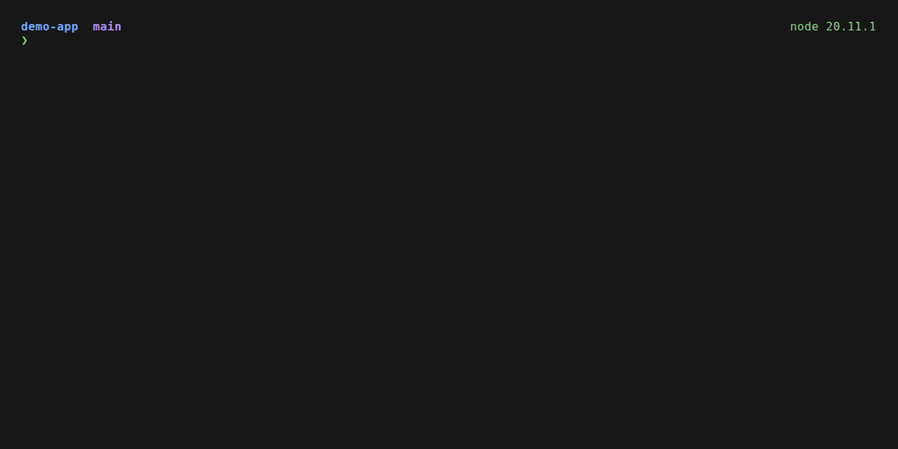

# bash-gitaware

A git-aware bash prompt that stays out of your way. Pure bash 4.4+, no
dependencies beyond git.



[Español](README.es.md) · [Migrating from v2](docs/MIGRATION.md) ·
[Decisions](docs/adr/) · [Changelog](CHANGELOG.md) · [Security](SECURITY.md)

## What you see

```text
❯ make test
...output...
  ✘1 · 3s
~/src/project  main ● ↑1                              python 3.12
❯ _
```

- Line 1: the path (relative to the repository root inside a repository)
  and git. Git shows the branch, rebase or merge state, a dirty mark,
  ahead/behind counts and stashes. Runtimes (Python, Node, Rust, Go) are
  aligned to the right.
- Line 2: the prompt symbol, red after a failure.
- After a command that failed or took longer than the threshold, a result
  line (`  ✘1 · 3s`) stays in your scrollback.
- When you press Enter, the prompt collapses to `❯ <command>`, so
  scrollback stays compact.

The expensive part of `git status` runs in the background. In a
100,000-file repository the prompt costs about 11 ms.

## Install

```bash
git clone https://github.com/SzematPro/bash-gitaware ~/.bash-gitaware
cd ~/.bash-gitaware
./install.sh            # asks: append to ~/.bashrc or replace it, theme, glyphs
exec bash
```

Use `./install.sh --yes` to take the defaults without questions, and
`./install.sh --uninstall` to undo the install.

## Configure

Settings live in `~/.config/bash-gitaware/config`. The file is plain
`key = value` and is never sourced. Change settings with `bga`:

```bash
bga config set theme light      # aware, light, contrast
bga config set style classic    # the v2 three-line layout
bga theme preview contrast
bga doctor                      # checks your setup
bga reload                      # applies changes to this shell
```

| Key | Values | Default |
|---|---|---|
| `style` | `lean`, `classic` | `lean` |
| `theme` | `aware`, `light`, `contrast` | `aware` |
| `glyphs` | `nerd`, `unicode`, `ascii` | auto (`unicode` on UTF-8) |
| `clock` | `0`, `1` | `0` |
| `commit_line` | `0`, `1` | `0` in Lean, `1` in classic |
| `path_maxdepth` | number (`0` means no limit) | `3` |
| `timer_threshold` | seconds | `2` |
| `show_host` | `auto`, `always`, `never` | `auto` (over SSH or as root) |
| `mode` | `auto`, `plain`, `full` | `auto` |

Every key also works as an environment variable (`BASHGITAWARE_THEME`,
and so on), which takes precedence over the file. `NO_COLOR` is honored.
The full list is in [docs/MIGRATION.md](docs/MIGRATION.md).

## Plain mode

On a dumb terminal, without a tty, or when `CI`, `AGENT` or `AI_AGENT` is
set, the prompt is a single ASCII line with no escape sequences:
`project (main *) [exit 1] $`. Set `mode = full` to always get the full
prompt.

## Safety

The prompt shows text that comes from repositories you may have just
downloaded: branch names, commit subjects, directory names, version files.
That text is always shown, never run, and terminal escape sequences are
stripped from it. The prompt's own git calls never run hooks, fsmonitor,
repository-local filter drivers or lazy fetches, and each call has a time
limit. See [SECURITY.md](SECURITY.md) and
[ADR-0008](docs/adr/ADR-0008-v3-git-worker-trust-and-state.md).

## Compatibility

| Platform | bash | Status |
|---|---|---|
| Linux, glibc or musl | 4.4, 5.0, 5.1, 5.2, 5.3 | Tested in CI |
| macOS | Homebrew bash 5.x | Tested in CI (the stock bash 3.2 is too old) |

## Development

```bash
make build      # lib/*.bash -> new.bashrc
make test       # the test suite
make lint       # shellcheck
```

The source is in `lib/` and the design records are in `docs/adr/`. The
manual checks are in `tests/MANUAL.md`.

## License

MIT. Copyright (c) 2024-2026 Waldemar Szemat (SzematPro).
